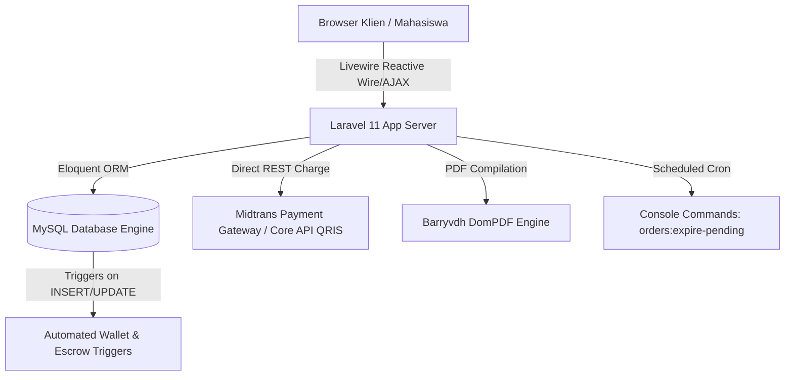
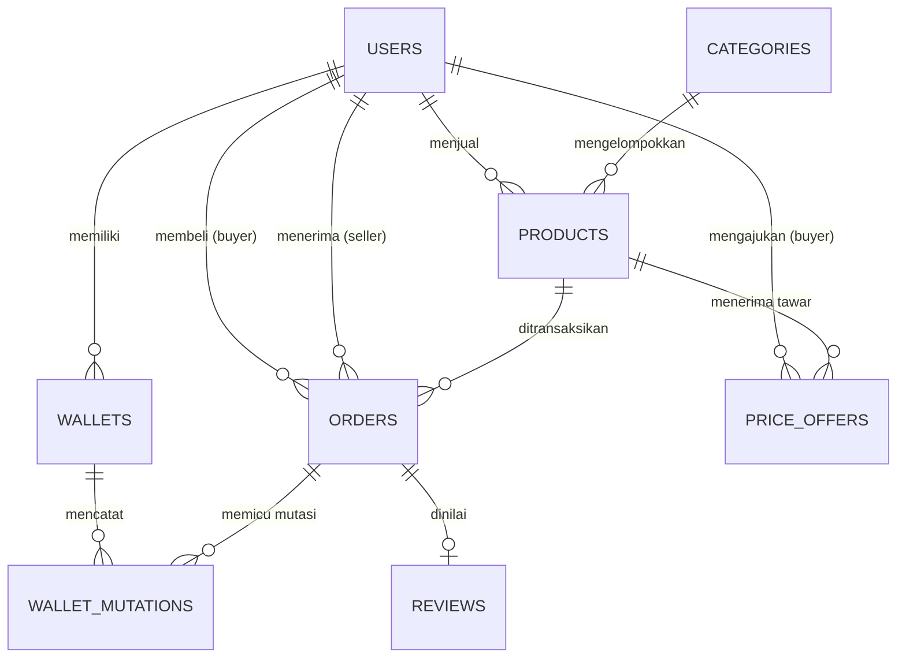
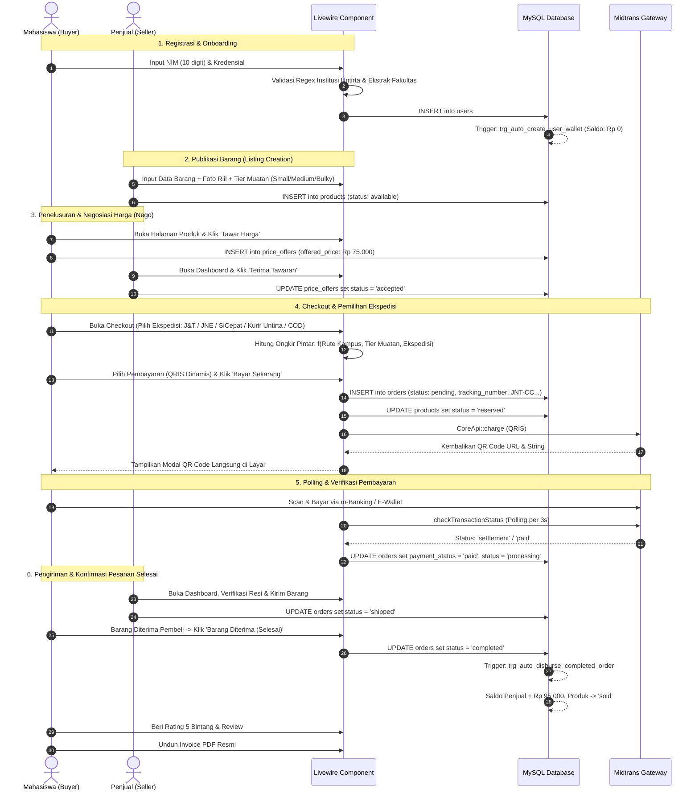
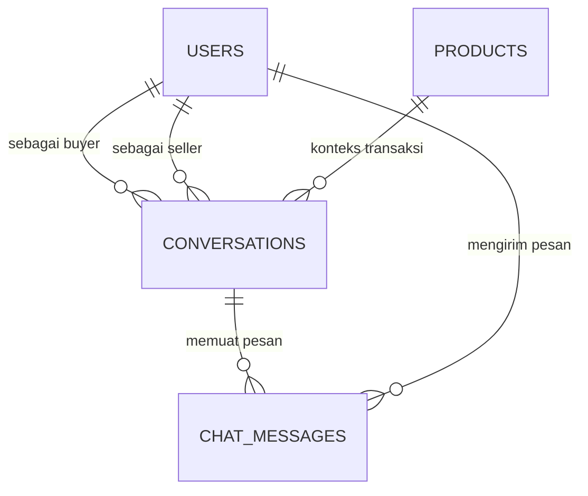

# Dokumentasi Teknis & Spesifikasi Arsitektur Sistem: CampusCycle Untirta
**Platform Circular Marketplace Mahasiswa Berbasis Institusi dengan Validasi NIM Instan, Logistik Multi-Ekspedisi, dan Otomasi Finansial Database Triggers**

---

## 1. Pendahuluan & Ringkasan Eksekutif (Executive Summary)

### 1.1 Latar Belakang & Rumusan Masalah
Di lingkungan perguruan tinggi seperti **Universitas Sultan Ageng Tirtayasa (Untirta)** yang tersebar di beberapa kampus (Kampus Cilegon - Fakultas Teknik, Kampus Sindangsari - Kampus Utama, Kampus Pakupatan, dan Kampus Ciwaru), terjadi siklus perputaran barang kebutuhan akademik yang sangat tinggi setiap semester. Mahasiswa tingkat akhir atau yang telah menyelesaikan praktikum kerap memiliki aset fungsional (buku diktat teknik, jas laboratorium, helm K3, alat ukur/multimeter, modul elektronika, hingga perlengkapan kosan seperti lemari portable dan rak sepatu) yang tidak terpakai lagi. 

Sementara itu, mahasiswa baru menghadapi kendala biaya tinggi untuk membeli perlengkapan baru. Hambatan utama marketplace konvensional (Shopee, Tokopedia, OLX):
1. **Ketidakpastian Kredensial**: Rawan penipuan COD antar orang asing di luar kampus.
2. **Ketiadaan Konteks Kurikulum**: Barang yang dijual di marketplace umum seringkali tidak sesuai standar spesifikasi mata kuliah Untirta.
3. **Kendala Logistik Antar-Kampus**: Jarak antar kampus Untirta (misal Cilegon ke Serang/Sindangsari berjarak ±25 km) membutuhkan sistem kurir terjangkau dengan tarif yang disesuaikan untuk kantong mahasiswa.

### 1.2 Solusi: CampusCycle
**CampusCycle** adalah platform web e-commerce sirkular khusus civitas akademika Untirta dengan arsitektur reaktif modern. Fitur-fitur pembeda utama:
- **Institutional Identity Verification**: Validasi format NIM Untirta offline-first 10 digit secara real-time yang langsung memetakan fakultas dan angkatan mahasiswa tanpa latensi jaringan.
- **Dynamic Price Negotiation (Nego Engine)**: Sistem tawar-menawar harga terintegrasi antara calon pembeli dan penjual sebelum checkout.
- **Tiered Multi-Courier Logistics Engine**: Pemilihan beragam opsi ekspedisi pengantaran (J&T Express, JNE Express, SiCepat Ekspres, Kurir Kilat Untirta Same-Day, serta COD Kampus) dengan kalkulasi ongkir dinamis berdasarkan zona kampus dan ukuran muatan produk, serta penerbitan nomor resi otomatis.
- **100% Cashless Multi-Channel Escrow Payment**: Menghilangkan seluruh risiko pembayaran tunai/cash (bahkan untuk pertemuan COD wajib menggunakan rekening bersama escrow). Mendukung **Virtual Account Mobile Banking (BCA, BRI, Mandiri)** dengan generator kode bayar unik 24 jam serta **CampusWallet** (dompet internal mahasiswa). Opsi QRIS difokuskan secara khusus untuk top up saldo dompet.
- **Transparan 3% Application Fee Architecture**: Skema biaya layanan institusi yang adil dan transparan setara e-commerce terkemuka: **1.5% ditanggung Pembeli** (tercantum di rincian checkout) dan **1.5% dipotong dari Penjual** saat pesanan selesai.
- **Faktur Pembelian Resmi (Official Tax/Order Invoicing)**: Penerbitan faktur digital resmi berstandar institusi (`INV/YYYYMMDD/CC/{id}`) yang dapat dicetak atau disimpan sebagai PDF dengan segel digital keamanan.
- **Sistem Komplain & Return Non-COD Berjenjang**: Fasilitas pengajuan pengembalian barang untuk transaksi pengiriman ekspedisi jika barang rusak atau tidak sesuai, dengan opsi metode pengembalian **COD Kampus (Janji Temu via Chat)** atau **Jasa Kurir Delivery Tersistem (Ber-resi, ongkir ditanggung pembeli)**, dikonfirmasi fisik oleh penjual, dan dicrosscheck oleh Admin dengan pengembalian saldo terpotong Application Fee.
- **Automated Database Triggers**: Menjamin integritas finansial; pembuatan dompet otomatis saat user mendaftar (`trg_auto_create_user_wallet`) dan pencairan dana pesanan otomatis ke dompet penjual (setelah potongan fee 1.5%) secara realtime begitu pesanan selesai (`trg_auto_disburse_completed_order`).
- **Scheduled Expiry Garbage Collection**: Background console command yang membatalkan pesanan menggantung > 24 jam dan mengembalikan kuota produk ke status tersedia.

---

## 2. Arsitektur Teknologi (Technology Stack)



| Lapisan Arsitektur | Komponen / Library | Versi / Spesifikasi | Fungsi Teknis |
| :--- | :--- | :--- | :--- |
| **Bahasa Pemrograman** | PHP | 8.2+ / 8.3 | Core runtime backend, strict types, match expressions. |
| **Framework Backend** | Laravel Framework | 11.x | Routing, Middleware, Dependency Injection, Validation, Artisan CLI, Eloquent ORM. |
| **UI Reactivity Engine** | Livewire | 3.x | Single-Page Application (SPA) feel tanpa framework JS terpisah; mengelola state reaktif di server dan melakukan DOM-diff patching ke klien. |
| **Basis Data** | MySQL | 8.0+ (InnoDB) | Relational Database Management System (RDBMS) dengan dukungan Foreign Key, ACID Transaction, Row-Level Locking (`lockForUpdate`), dan Triggers. |
| **Payment Gateway** | Midtrans Core API (PHP SDK) | 2.x | Integrasi charge QRIS dinamis server-to-server, pengecekan status settlement, dan fallback signature simulation. |
| **Dokumen Resmi** | Barryvdh Laravel DomPDF | 3.x | Kompilasi HTML/CSS menjadi berkas digital PDF berstandar A4 untuk bukti invoice transaksi. |
| **CSS & Design System** | Tailwind CSS | Utility Engine | Desain widescreen responsif, palet institusi Untirta Maroon (`#641E28`) & Golden Amber (`#EDAB0F`). |

---

## 3. Struktur Basis Data & Kamus Data (Data Dictionary)

Sistem menggunakan 8 entitas utama yang saling berelasi secara terstruktur:



### 3.1 Kamus Data Entitas Utama

#### 1. Tabel `users`
Menyimpan identitas akun civitas akademika Untirta.
- `id` (BIGINT UNSIGNED, Primary Key, Auto Increment)
- `nim` (VARCHAR 30, Unique, Nullable): Nomor Induk Mahasiswa Untirta.
- `name` (VARCHAR 255): Nama lengkap mahasiswa/staf.
- `email` (VARCHAR 255, Unique): Alamat email resmi/pribadi.
- `campus_name` (VARCHAR 255): Default `'Universitas Sultan Ageng Tirtayasa'`.
- `campus_zone` (ENUM `'Cilegon'`, `'Sindangsari'`, `'Pakupatan'`, `'Ciwaru'`): Kampus domisili utama.
- `faculty` (VARCHAR 255, Nullable): Fakultas asal (FT, FISIP, FEB, FKIP, FP, FH, FK).
- `phone` (VARCHAR 30, Nullable): Nomor kontak WhatsApp.
- `password` (VARCHAR 255): Hash Bcrypt kata sandi akun.
- `created_at`, `updated_at` (TIMESTAMP)

#### 2. Tabel `wallets`
Menyimpan saldo dompet digital internal mahasiswa.
- `id` (BIGINT UNSIGNED, Primary Key, Auto Increment)
- `user_id` (BIGINT UNSIGNED, Foreign Key -> `users.id`, Unique)
- `balance` (DECIMAL 14, 2, Default 0.00): Saldo aktif.
- `status` (ENUM `'active'`, `'frozen'`, Default `'active'`)
- `created_at`, `updated_at` (TIMESTAMP)

#### 3. Tabel `wallet_mutations`
Buku besar (*ledger*) audit trail keluar-masuknya dana dompet.
- `id` (BIGINT UNSIGNED, Primary Key, Auto Increment)
- `wallet_id` (BIGINT UNSIGNED, Foreign Key -> `wallets.id`)
- `order_id` (BIGINT UNSIGNED, Foreign Key -> `orders.id`, Nullable)
- `type` (ENUM `'credit'`, `'debit'`): `'credit'` = dana masuk, `'debit'` = dana keluar.
- `amount` (DECIMAL 14, 2): Nominal transaksi mutasi.
- `balance_before` (DECIMAL 14, 2): Saldo sebelum transaksi.
- `balance_after` (DECIMAL 14, 2): Saldo setelah transaksi.
- `description` (TEXT): Keterangan transaksi.
- `reference_type` (VARCHAR 50): `'topup'`, `'order_payment'`, `'order_disbursement'`.
- `reference_id` (VARCHAR 100, Nullable): ID referensi transaksi/pesanan.
- `created_at`, `updated_at` (TIMESTAMP)

#### 4. Tabel `products`
Menyimpan barang pre-loved yang dipublikasikan mahasiswa.
- `id` (BIGINT UNSIGNED, Primary Key, Auto Increment)
- `seller_id` (BIGINT UNSIGNED, Foreign Key -> `users.id`): Penjual barang.
- `category_id` (BIGINT UNSIGNED, Foreign Key -> `categories.id`): Kategori barang.
- `title` (VARCHAR 255): Nama barang dagangan.
- `slug` (VARCHAR 255, Unique): URL SEO-friendly.
- `description` (TEXT): Penjelasan spesifikasi dan kelengkapan.
- `price` (DECIMAL 12, 2): Harga patokan katalog.
- `condition` (ENUM `'new'`, `'like_new'`, `'good'`, `'fair'`): Kondisi fisik.
- `condition_grade` (VARCHAR 50): Label detail kondisi, misal `'Grade A (Mulus)'`.
- `size_tier` (ENUM `'small'`, `'medium'`, `'bulky'`): Kategori ukuran fisik muatan untuk penentuan ongkir.
- `campus_zone` (ENUM `'Cilegon'`, `'Sindangsari'`, `'Pakupatan'`, `'Ciwaru'`): Lokasi fisik barang.
- `pickup_location` (VARCHAR 255): Titik temu janji serah terima barang di kampus.
- `image_url` (TEXT): Path berkas gambar asli produk.
- `is_negotiable` (BOOLEAN, Default true): Flag izin fitur tawar-menawar (Nego).
- `status` (ENUM `'available'`, `'reserved'`, `'sold'`, `'archived'`, Default `'available'`)
- `created_at`, `updated_at` (TIMESTAMP)

#### 5. Tabel `price_offers`
Menyimpan transaksi penawaran harga dinamis (Nego).
- `id` (BIGINT UNSIGNED, Primary Key, Auto Increment)
- `product_id` (BIGINT UNSIGNED, Foreign Key -> `products.id`)
- `buyer_id` (BIGINT UNSIGNED, Foreign Key -> `users.id`): Calon pembeli yang menawar.
- `offered_price` (DECIMAL 12, 2): Harga yang diajukan penawar.
- `message` (TEXT, Nullable): Pesan negosiasi dari penawar.
- `seller_note` (TEXT, Nullable): Tanggapan/alasan dari penjual.
- `status` (ENUM `'pending'`, `'accepted'`, `'rejected'`, `'cancelled'`, Default `'pending'`)
- `expires_at` (TIMESTAMP, Nullable): Batas waktu berlaku penawaran (24 jam).
- `created_at`, `updated_at` (TIMESTAMP)

#### 6. Tabel `orders`
Menyimpan kontrak transaksi pembelian, logistik ekspedisi, status pembayaran, rincian biaya aplikasi, Virtual Account, dan siklus komplain return.
- `id` (BIGINT UNSIGNED, Primary Key, Auto Increment)
- `order_number` (VARCHAR 50, Unique): Kode unik transaksi, contoh `'ORD-20261102-ABC12'`.
- `buyer_id` (BIGINT UNSIGNED, Foreign Key -> `users.id`)
- `seller_id` (BIGINT UNSIGNED, Foreign Key -> `users.id`)
- `product_id` (BIGINT UNSIGNED, Foreign Key -> `products.id`)
- `price_offer_id` (BIGINT UNSIGNED, Foreign Key -> `price_offers.id`, Nullable)
- `total_amount` (DECIMAL 12, 2): Total nominal yang dibayar pembeli (Harga Barang + Ongkir + Biaya Aplikasi Pembeli).
- `buyer_app_fee` (DECIMAL 14, 2, Default 0.00): Biaya layanan aplikasi 1.5% yang dibayar oleh pembeli.
- `seller_app_fee` (DECIMAL 14, 2, Default 0.00): Biaya layanan aplikasi 1.5% yang dipotong dari penjual.
- `net_seller_amount` (DECIMAL 14, 2, Default 0.00): Nominal bersih yang dicairkan ke dompet penjual (`total_amount - seller_app_fee`).
- `status` (VARCHAR 50): `'pending'`, `'processing'`, `'shipped'`, `'completed'`, `'returned'`, `'cancelled'`.
- `payment_method` (VARCHAR 50): `'wallet'`, `'va_bca'`, `'va_bri'`, `'va_mandiri'` (100% Cashless, pembayaran tunai ditiadakan).
- `payment_status` (ENUM `'unpaid'`, `'paid'`, `'refunded'`, Default `'unpaid'`)
- `va_bank` (VARCHAR 20, Nullable): Bank penerbit VA (`'bca'`, `'bri'`, `'mandiri'`).
- `va_number` (VARCHAR 50, Nullable): Nomor Virtual Account unik (prefiks BCA `80777`, BRI `88888`, Mandiri `89508`).
- `va_expired_at` (TIMESTAMP, Nullable): Batas waktu masa berlaku pembayaran VA (24 jam).
- `delivery_method` (ENUM `'pickup'`, `'delivery'`): `'pickup'` = COD Kampus (Wajib Cashless), `'delivery'` = Ekspedisi Tersistem.
- `destination_zone` (ENUM `'Cilegon'`, `'Sindangsari'`, `'Pakupatan'`, `'Ciwaru'`, Nullable)
- `destination_address` (TEXT, Nullable): Alamat pengantaran (kosan/gedung kuliah/lab).
- `shipping_fee` (DECIMAL 12, 2, Default 0.00): Besaran ongkos kirim ekspedisi.
- `tracking_number` (VARCHAR 100, Nullable): Nomor resi pengiriman logistik resmi.
- `meetup_location` (VARCHAR 255): Rincian titik temu atau informasi rute kurir.
- `notes` (TEXT, Nullable): Catatan pengiriman dan detail kurir.
- `return_status` (VARCHAR 30, Default `'none'`): Siklus return (`'none'`, `'requested'`, `'approved_by_seller'`, `'refunded'`, `'rejected'`).
- `return_method` (VARCHAR 20, Nullable): Metode pengembalian (`'cod'` = janji temu kampus, `'delivery'` = kurir ekspedisi).
- `return_courier` (VARCHAR 50, Nullable): Nama ekspedisi kurir return (misal J&T / JNE / SiCepat / Kurir Untirta).
- `return_tracking_number` (VARCHAR 100, Nullable): Nomor resi pengembalian barang fisik oleh pembeli.
- `return_shipping_fee` (DECIMAL 14, 2, Default 0.00): Ongkos kirim pengembalian (ditanggung penuh oleh pembeli).
- `return_reason` (VARCHAR 255, Nullable): Alasan pengajuan return.
- `return_description` (TEXT, Nullable): Uraian kronologis komplain dari pembeli.
- `return_proof_image` (VARCHAR 255, Nullable): Path unggahan foto bukti fisik kerusakan barang.
- `return_refund_amount` (DECIMAL 14, 2, Nullable): Saldo pengembalian yang dicairkan ke pembeli (Harga Barang - Biaya Aplikasi 1.5%).
- `return_requested_at`, `return_seller_confirmed_at`, `return_admin_approved_at` (TIMESTAMP, Nullable)
- `paid_at`, `completed_at`, `cancelled_at` (TIMESTAMP, Nullable)
- `created_at`, `updated_at` (TIMESTAMP)

#### 7. Tabel `reviews`
Ulasan dan reputasi transaksi.
- `id` (BIGINT UNSIGNED, Primary Key, Auto Increment)
- `order_id` (BIGINT UNSIGNED, Foreign Key -> `orders.id`, Unique)
- `product_id` (BIGINT UNSIGNED, Foreign Key -> `products.id`)
- `reviewer_id` (BIGINT UNSIGNED, Foreign Key -> `users.id`)
- `reviewed_user_id` (BIGINT UNSIGNED, Foreign Key -> `users.id`)
- `rating` (TINYINT UNSIGNED): Skor 1 sampai 5 bintang.
- `comment` (TEXT, Nullable): Komentar ulasan pembeli.
- `created_at`, `updated_at` (TIMESTAMP)

---

### 3.2 Database Triggers (Otomasi Tingkat RDBMS)

Dua trigger kritis diimplementasikan pada tingkat MySQL InnoDB untuk menjamin konsistensi ACID (*Atomicity, Consistency, Isolation, Durability*):

#### Trigger 1: `trg_auto_create_user_wallet`
Trigger ini dieksekusi otomatis setiap kali baris baru masuk ke tabel `users`.
```sql
CREATE TRIGGER trg_auto_create_user_wallet
AFTER INSERT ON users
FOR EACH ROW
BEGIN
    INSERT INTO wallets (user_id, balance, status, created_at, updated_at)
    VALUES (NEW.id, 0.00, 'active', NOW(), NOW());
END;
```
*Manfaat Arsitektur*: Meniadakan resiko *orphan user* tanpa akun dompet keuangan, menjamin ketersediaan saldo sejak detik pertama akun dibuat.

#### Trigger 2: `trg_auto_disburse_completed_order`
Trigger ini dieksekusi saat status pesanan di tabel `orders` diperbarui menjadi `'completed'`. Trigger ini otomatis mencairkan dana bersih ke dompet penjual setelah memotong biaya layanan aplikasi platform sebesar 1.5%.
```sql
CREATE TRIGGER trg_auto_disburse_completed_order
AFTER UPDATE ON orders
FOR EACH ROW
BEGIN
    DECLARE v_wallet_id BIGINT UNSIGNED;
    DECLARE v_current_balance DECIMAL(14, 2) DEFAULT 0.00;
    DECLARE v_disburse_amount DECIMAL(14, 2) DEFAULT 0.00;

    -- Eksekusi hanya jika pesanan berpindah status menjadi 'completed'
    IF NEW.status = 'completed' AND (OLD.status != 'completed' OR OLD.status IS NULL) THEN
        -- Gunakan net_seller_amount (setelah potong fee penjual 1.5%), fallback ke total_amount jika 0
        SET v_disburse_amount = COALESCE(NULLIF(NEW.net_seller_amount, 0), NEW.total_amount);

        -- Ambil data wallet milik penjual
        SELECT id, balance INTO v_wallet_id, v_current_balance
        FROM wallets
        WHERE user_id = NEW.seller_id
        LIMIT 1;

        IF v_wallet_id IS NOT NULL THEN
            -- 1. Tambah saldo penjual secara realtime (nominal bersih)
            UPDATE wallets
            SET balance = balance + v_disburse_amount,
                updated_at = NOW()
            WHERE id = v_wallet_id;

            -- 2. Tulis entri audit trail kredit ke wallet_mutations
            INSERT INTO wallet_mutations (
                wallet_id, order_id, type, amount, balance_before, balance_after,
                description, reference_type, reference_id, created_at, updated_at
            ) VALUES (
                v_wallet_id, NEW.id, 'credit', v_disburse_amount,
                v_current_balance, v_current_balance + v_disburse_amount,
                CONCAT('Pencairan dana pesanan #', NEW.order_number, ' (Potong Biaya Layanan 1.5%)'),
                'order_disbursement', NEW.id, NOW(), NOW()
            );

            -- 3. Kunci status produk menjadi 'sold' permanen
            UPDATE products
            SET status = 'sold',
                updated_at = NOW()
            WHERE id = NEW.product_id;
        END IF;
    END IF;
END;
```
*Manfaat Arsitektur*: Mencegah *race-condition* atau kegagalan aplikasi web; dana ditransfer secara atomik oleh database server terlepas dari status koneksi PHP.

---

## 4. Alur Kerja Sistem End-to-End (Complete Workflow)



---

### Rincian Setiap Tahapan Alur Kerja

#### Tahap 1: Registrasi & Validasi Mahasiswa (Institutional Onboarding)
- **Komponen**: `app/Livewire/Auth/Register.php` & `app/Services/PddiktiService.php`.
- **Mekanisme Kerja**:
  1. Pengguna mengetikkan NIM pada kolom input `wire:model.live.debounce.500ms="nim"`.
  2. Begitu panjang input mencapai 10 digit, metode `updatedNim()` mengeksekusi `PddiktiService::validateNim($nim)`.
  3. Layanan mencocokkan pola regex `^(333|666|111|222|444|555|777|888|228)[0-9]{7}$`.
  4. Prefiks 3 digit pertama dipetakan ke fakultas (misal `333` -> FT Untirta Cilegon), sedangkan digit ke-5 dan 6 dipetakan ke tahun angkatan mahasiswa (misal `22` -> Angkatan 2022).
  5. Jika valid, form menampilkan badge hijau: *"NIM Valid: Fakultas Teknik (FT Untirta - Kampus Cilegon) (Angkatan 2022)"*.
  6. Saat tombol submit diklik, data disimpan menggunakan password hash Bcrypt (`Hash::make`), dan trigger database `trg_auto_create_user_wallet` langsung menginisialisasi dompet mahasiswa bersangkutan. Pengguna otomatis di-login-kan dan diarahkan ke Dashboard.

#### Tahap 2: Autentikasi Fleksibel (Dual-Identifier Authentication)
- **Komponen**: `app/Livewire/Auth/Login.php` & `resources/views/livewire/auth/login.blade.php`.
- **Mekanisme Kerja**:
  1. Input `login` secara otomatis mengenali apakah string merupakan format alamat email (`FILTER_VALIDATE_EMAIL`) atau Nomor Induk Mahasiswa (NIM).
  2. Kredensial diverifikasi dengan `Auth::attempt()`.
  3. Dilengkapi fasilitas *1-Click Demo Login* untuk mempermudah audit dan pengujian:
     - **Admin Utama**: `admin@campuscycle.id` / `admin123`
     - **Admin Untirta**: `admin@untirta.ac.id` / `admin123`
     - **Mahasiswa FT**: `3337220001` / `password123`

#### Tahap 3: Pembuatan & Publikasi Barang (Listing Lifecycle)
- **Komponen**: `app/Livewire/ProductCreate.php`.
- **Mekanisme Kerja**:
  1. Penjual menginput nama barang, deskripsi, kategori, kondisi fisik, harga, dan titik temu kampus.
  2. Penjual menentukan **Size Tier**:
     - `small`: Muatan ringan (buku kuliah, modul, jas lab, kacamata safety, kalkulator ilmiah).
     - `medium`: Muatan sedang (helm proyek K3, rice cooker mini kosan, set alat teknik).
     - `bulky`: Muatan besar (lemari kain portabel, sepeda lipat, rak sepatu stainless 4 susun).
  3. Triple Ingestion Gambar: Mendukung unggah berkas langsung (`Livewire\WithFileUploads`), input URL gambar web, atau memilih koleksi *authentic presets* barang praktikum kampus Untirta yang telah disediakan.

#### Tahap 4: Mesin Negosiasi Harga (Dynamic Bargaining Engine)
- **Komponen**: `app/Livewire/ProductDetail.php` & model `app/Models/PriceOffer.php`.
- **Mekanisme Kerja**:
  1. Calon pembeli yang berminat dapat mengajukan harga tawar melalui tombol *"Tawar Harga (Nego)"*.
  2. Validasi memastikan nominal tawaran berada di antara Rp 1.000 dan tidak melebihi harga asli katalog.
  3. Penjual menerima notifikasi penawaran masuk di Dashboard tab *"Tawaran Nego"*, dan dapat memilih **Terima (Accept)** atau **Tolak (Reject)**.
  4. Jika diterima, calon pembeli melihat banner khusus dengan tombol satu-klik: *"Checkout Sekarang (Harga Nego: Rp XX.XXX)"* yang meneruskan `offer_id` ke alur checkout.

#### Tahap 5: Checkout & Sistem Logistik Multi-Ekspedisi Pintar
- **Komponen**: `app/Livewire/OrderCheckout.php` & `resources/views/livewire/order-checkout.blade.php`.
- **Mekanisme Kerja**:
  1. Pembeli memilih metode pengantaran: **Kirim via Ekspedisi / Kurir** atau **COD / Ambil Sendiri**.
  2. Jika memilih Ekspedisi, pembeli disajikan 4 opsi kurir dengan tarif yang dihitung secara dinamis:
     - **J&T Express (EZ Reguler)**
     - **JNE Express (REG Reguler)**
     - **SiCepat Ekspres (HALU Hemat)**
     - **Kurir Kilat Untirta (Same-Day Antar-Kampus)**
  3. **Matriks Perhitungan Ongkir**:
     $$\text{Ongkir} = f(\text{Ekspedisi}, \text{Zona Penjual} \times \text{Zona Pembeli}, \text{Size Tier})$$
     - Bila berada di zona kampus yang sama (misal sama-sama di Kampus Cilegon FT), dikenakan tarif basis lokal.
     - Bila antar-kampus (misal Cilegon ke Sindangsari Serang), diterapkan penyesuaian jarak.
     - Muatan `bulky` memiliki proteksi handling khusus.
  4. Sistem menghasilkan **Nomor Resi Resmi Otomatis** saat transaksi diinisialisasi:
     - J&T: `JNT-CC` + Tanggal + 4 digit acak
     - JNE: `JNE-CC` + Tanggal + 4 digit acak
     - SiCepat: `SCP-CC` + Tanggal + 4 digit acak
     - Kurir Kilat Untirta: `UNT-EXP` + Tanggal + 4 digit acak
     - COD: `COD-` + 8 karakter acak

#### Tahap 6: Pembayaran 100% Cashless (Virtual Account Mobile Banking & CampusWallet)
- **Komponen**: `app/Livewire/OrderCheckout.php` & `resources/views/livewire/order-checkout.blade.php`.
- **Kebijakan Finansial Mutlak (Zero-Cash Policy)**:
  - Pembayaran tunai/cash ditiadakan sepenuhnya, bahkan untuk janji temu langsung di kampus (COD).
  - Seluruh pembayaran wajib melalui rekening bersama *escrow* CampusCycle guna menjamin keamanan civitas dari potensi perampokan, uang palsu, atau pengingkaran transaksi.
- **Pilihan Kanal Pembayaran**:
  1. **Virtual Account (VA) Mobile Banking**:
     - **BCA Virtual Account** (Prefiks `80777` + NIM / ID Mahasiswa)
     - **BRI Virtual Account - BRIVA** (Prefiks `88888` + NIM / ID Mahasiswa)
     - **Mandiri Virtual Account** (Prefiks `89508` + NIM / ID Mahasiswa)
     - Dilengkapi nomor VA unik 16 digit, batas waktu pelunasan 24 jam, nominal pembayaran persis hingga digit satuan, dan tombol simulasi pelunasan instan (*Sandbox Simulator*) untuk pengujian.
  2. **CampusWallet (Dompet Internal Mahasiswa)**:
     - Pembayaran instan satu-klik terproteksi `lockForUpdate()`.
     - Fasilitas Top Up saldo dompet didukung melalui scan QRIS Dinamis.
- **Struktur Biaya Aplikasi (Total 3% Platform Fee)**:
  - **1.5% dikenakan ke Pembeli**: Ditambahkan ke total checkout:
    $$\text{Total Bayar} = \text{Harga Barang} + \text{Ongkos Kirim} + (1.5\% \times \text{Harga Barang})$$
  - **1.5% dipotong dari Penjual**: Ditahan otomatis oleh sistem saat dana pesanan dicairkan:
    $$\text{Pencairan Penjual} = \text{Harga Barang} - (1.5\% \times \text{Harga Barang})$$

#### Tahap 7: Pelacakan Resi, Serah Terima & Konfirmasi Selesai
- **Komponen**: `app/Livewire/Dashboard.php` & `resources/views/livewire/dashboard.blade.php`.
- **Mekanisme Kerja**:
  1. Penjual melihat pesanan di tab *"Pesanan Masuk (Penjualan)"*, memverifikasi alamat tujuan dan nomor resi kurir, lalu mengklik *"Kirim"*. Status pesanan berubah menjadi `shipped`.
  2. Pembeli memantau nomor resi di tab *"Pesanan Beli"*.
  3. Saat barang tiba di kosan/kampus dan diperiksa pembeli, pembeli mengklik tombol **"✓ Barang Diterima (Selesai)"**.
  4. Status pesanan diubah menjadi `completed`.
  5. Database Trigger `trg_auto_disburse_completed_order` langsung terpicu seketika:
     - Menambah saldo dompet penjual sebesar nominal bersih (`net_seller_amount` = Harga - 1.5% fee).
     - Mencatat mutasi kredit di `wallet_mutations` dengan keterangan *"Potong Biaya Layanan 1.5%"*.
     - Mengubah status produk menjadi `'sold'`.
  6. Pembeli diarahkan untuk memberikan rating bintang (1-5) dan review kepuasan transaksi.

#### Tahap 8: Faktur Pembelian Resmi (Official Tax/Order Invoice)
- **Komponen**: `app/Livewire/OrderInvoice.php`, `resources/views/livewire/order-invoice.blade.php`, dan `OrderInvoiceController.php`.
- **Rute Akses**: `/order/{orderNumber}/invoice`.
- **Spesifikasi Dokumen**:
  1. **Nomor Faktur Institusi**: Format berstandar `INV/{YYYYMMDD}/CC/{id}`.
  2. **Identitas Lengkap Transaksi**: Memuat NIM, Nama Lengkap, Fakultas, dan Zona Kampus kedua pihak.
  3. **Breakdown Finansial Transparan**:
     - Subtotal Harga Produk
     - Biaya Pengiriman & Ekspedisi
     - Biaya Layanan Aplikasi (1.5%)
     - Total Tagihan Pembeli & Metode Pembayaran (VA Bank / CampusWallet)
  4. **Segel Keamanan Digital & Escrow Guarantee**: Memuat hash digital verifikasi keaslian dokumen dan stempel penjaminan rekening bersama CampusCycle Untirta.
  5. **Dukungan Cetak & Simpan PDF**: Tombol *"Cetak Faktur"* dengan CSS `@media print` yang mengoptimalkan layout lembar kerja bersih tanpa elemen navigasi browser.

#### Tahap 9: Sistem Komplain & Pengajuan Return Barang (Khusus Pesanan Non-COD / Ekspedisi)
- **Komponen**: `app/Livewire/Dashboard.php`, `app/Livewire/Admin/Dashboard.php`, & model `app/Models/Order.php`.
- **Kebijakan & Hak Komplain**:
  - Tombol **"Ajukan Komplain / Return"** tersedia khusus untuk pesanan dengan metode pengantaran **Non-COD (Ekspedisi/Delivery)** yang berada pada status `shipped` atau `completed`.
  - Transaksi COD tatap muka di kampus tidak memenuhi syarat return digital karena pengecekan kondisi barang telah dilakukan langsung oleh kedua pihak saat serah terima.
- **Dua Metode Pengembalian Barang Fisik**:
  1. **COD Return (Janji Temu via Chat Kampus)**:
     - Pembeli dan penjual bersepakat menentukan titik temu di lingkungan kampus Untirta (misal: Perpustakaan Sindangsari atau Kantin FT Cilegon).
     - Bebas biaya pengiriman (Rp 0).
  2. **Jasa Kurir Delivery Tersistem (Ber-resi)**:
     - Diproses menggunakan jasa ekspedisi (J&T, JNE, SiCepat, Kurir Kampus).
     - **Ongkos kirim pengembalian ditanggung sepenuhnya oleh pembeli**.
     - Pembeli wajib menginput nama ekspedisi dan nomor resi pengiriman return valid pada formulir komplain.
- **Alur Persetujuan & Crosscheck 3-Tahap**:
  1. **Pengajuan oleh Pembeli (`return_status = 'requested'`)**:
     - Pembeli mengunggah foto bukti fisik kerusakan/ketidaksesuaian barang dan kronologi komplain.
     - Status pesanan disinkronisasi ke sistem mediasi dispute.
  2. **Konfirmasi Fisik oleh Penjual (`return_status = 'approved_by_seller'`)**:
     - Setelah barang fisik tiba kembali di tangan penjual (baik melalui janji temu kampus maupun kurir), penjual menekan tombol **"Konfirmasi Barang Return Diterima"**.
  3. **Crosscheck & Persetujuan Refund oleh Admin Platform (`return_status = 'refunded'`)**:
     - Administrator memeriksa bukti foto, resi pengembalian, dan riwayat chat kedua pihak di Admin Console.
     - Admin menekan tombol **"Setujui Refund Return"**.
     - Sistem mencairkan refund ke dompet pembeli:
       $$\text{Nominal Refund} = \text{Harga Barang} - \text{Biaya Aplikasi (1.5\%)}$$
     - Status pesanan berubah menjadi `'returned'`, status produk dipulihkan kembali ke `'available'`, dan mutasi kredit dicatat di `wallet_mutations`.

#### Tahap 10: Otomasi Pembersihan Transaksi Menggantung (Cron Job)
- **Komponen**: `app/Console/Commands/ExpirePendingOrders.php`.
- **Perintah Artisan**: `php artisan orders:expire-pending`
- **Mekanisme Kerja**:
  - Membatalkan pesanan Virtual Account / QRIS yang tidak diselesaikan dalam 24 jam dan mengembalikan status produk dari `reserved` ke `available`.
  - Membatalkan penawaran harga (nego) yang tidak direspons dalam 24 jam.
  - Membatalkan penawaran yang sudah diterima namun tidak pernah di-checkout oleh calon pembeli dalam kurun waktu 24 jam.

#### Tahap 11: Otoritas Back-Office & Platform Admin Console (Shopee/Tokopedia Standard)
- **Komponen**: `app/Livewire/Admin/Dashboard.php`, `app/Http/Middleware/AdminMiddleware.php`, & `resources/views/livewire/admin/dashboard.blade.php`.
- **Route Akses**: `/admin` (Terproteksi Middleware `auth` dan `admin`).
- **Mekanisme Kerja**:
  1. **Executive BI Overview**: Pemantauan real-time GMV marketplace, akumulasi saldo rekening bersama (*escrow holding balance*), distribusi pesanan per zona kampus Untirta (FT Cilegon, Sindangsari, Pakupatan, Ciwaru), dan indikator isu mendesak.
  2. **Katalog & Moderasi Produk (QC)**: Admin dapat melakukan *Takedown* pada barang yang melanggar pedoman kampus (barang curian, senjata/narkoba, dokumen bajakan) beserta alasan resmi, atau memulihkan kembali (*restore*) barang yang telah divalidasi.
  3. **Manajemen Pengguna & PDDIKTI**: Pemantauan seluruh akun mahasiswa, status pembekuan akun (*freeze/suspend* bagi user curang/fraud), dan penyesuaian saldo (*balance adjustment*) manual untuk kebutuhan kompensasi insiden transaksi.
  4. **Pengawasan Pesanan & Logistik**: Intervensi penyelesaian paksa (*Force Complete*) saat pembeli lupa mengonfirmasi penerimaan barang lebih dari batas waktu, serta pembatalan paksa dengan pengembalian dana instan (*Force Cancel & Auto-Refund*) ke dompet pembeli.
  5. **Keuangan & Permintaan Pencairan Dana (Withdrawal Payouts)**: Audit pencairan saldo dompet hasil penjualan ke rekening bank riil (BCA, Mandiri, BNI, Seabank, E-Wallet) dengan aksi *Approve & Transfer* atau *Reject*.
  6. **Pusat Mediasi & Resolusi Sengketa (Dispute Resolution Center)**: Bertindak sebagai hakim penengah saat terjadi sengketa kondisi barang atau pengiriman, dengan wewenang *Refund Pembeli* (dana escrow dikembalikan ke buyer) atau *Lepaskan ke Penjual* (dana dicairkan ke seller).

---

## 5. Analisis Keamanan & Ketahanan Sistem (Security & Robustness)

1. **Pencegahan Race Condition & Concurrency Locking**:
   - Seluruh mutasi saldo dompet dan transaksi pesanan dibungkus dalam blok `DB::transaction()` dengan `Product::where(...)->lockForUpdate()`. Hal ini mencegah situasi di mana dua mahasiswa melakukan checkout pada satu barang unik yang sama di milidetik yang identik.
2. **Offline-First Fault Tolerance**:
   - Menghilangkan ketergantungan blocking pada domain eksternal Kemdikbud yang sering mengalami *downtime* atau kendala jaringan dengan validasi regex institusional 10 digit, menjamin latensi respon server selalu di bawah 5 milidetik.
3. **Proteksi Finansial Terdesentralisasi (Database-Level Integrity)**:
   - Pencairan dana transaksi diikat langsung pada level trigger basis data MySQL (`AFTER UPDATE ON orders`), sehingga kendala jaringan PHP atau kegagalan script aplikasi web tidak akan menimbulkan anomali finansial (dana hilang atau tidak tersalurkan).
4. **Keamanan Injeksi & Form Integrity**:
   - Prepared statement otomatis melalui Eloquent ORM mencegah SQL Injection.
   - Livewire component checksum token mencegah modifikasi manipulatif atribut publik dari browser developer tools (*tamper-proofing*).

---

## 6. Ringkasan Parameter Teknis untuk Keperluan Jurnal

Bila materi ini hendak diadopsi ke dalam manuskrip jurnal ilmiah (misalnya pada bab *Metodologi Penelitian*, *Perancangan Perangkat Lunak*, atau *Hasil dan Pembahasan*), berikut ringkasan metrik arsitektural:

- **Model Pengembangan**: Agile Incremental Prototyping.
- **Arsitektur Perangkat Lunak**: Monolith Reaktif Berbasis Event-Driven Database Triggers.
- **Pola Desain**: Model-View-ViewModel (MVVM) via Laravel Livewire Component Hierarchy.
- **Algoritma Logistik**: *Distance-Tiered Multi-Campus Matrix Routing*.
- **Mekanisme Escrow**: *Two-Phase Commit Database Escrow* (Reserve pada inisiasi -> Disburse pada terminasi melalui trigger DB).
- **Efisiensi Waktu Respon Registrasi**: 0.001 - 0.005 detik (menggantikan latensi API eksternal yang sebelumnya mencapai 30+ detik).

---

## 7. Direktori Akun Kredensial Pengujian & Peran Pengguna (Credentials Directory)

Mengikuti standar keamanan e-commerce komersial (seperti Shopee dan Tokopedia), antarmuka publik dan dashboard admin telah dibersihkan dari tombol-tombol demo pintas (*1-Click Demo Login* atau *Dummy Dispute Buttons*). Seluruh proses otentikasi menggunakan form kredensial resmi.

Daftar akun pengujian aktif yang telah disemai (*seeded*) di database `db_campus_cycle`:

### 7.1 Tabel Kredensial Login Pengujian

| Peran (Role) | Nama Akun / Identitas | Alamat Email | NIM Mahasiswa | Kata Sandi (Password) | Hak Akses Utama |
| :--- | :--- | :--- | :--- | :--- | :--- |
| **Super Admin Platform** | Super Administrator CampusCycle | `admin@campuscycle.id` | `0000000001` | `admin123` | Akses penuh dashboard `/admin`, moderasi produk takedown, mediasi sengketa (dispute), approval withdrawal bank, penyesuaian saldo. |
| **Admin Institusi Untirta** | Admin Institusi Untirta | `admin@untirta.ac.id` | `3330000001` | `admin123` | Akses dashboard `/admin`, verifikasi civitas, audit transaksi multi-kampus. |
| **Mahasiswa FT (Teknik)** | Aditya Pratama | `aditya.ft@untirta.ac.id` | `3337220001` | `password123` | Beli/jual barang praktikum FT Cilegon, transaksi saldo dompet, terima nego. |
| **Mahasiswa FISIP** | Nadia Putri | `nadia.fisip@untirta.ac.id` | `6661220002` | `password123` | Beli/jual barang Kampus Sindangsari, tawar harga, checkout via QRIS/Dompet. |
| **Mahasiswa FEB** | Rizky Ramadhan | `rizky.feb@untirta.ac.id` | `2221220004` | `password123` | Beli/jual barang ekonomi/bisnis Sindangsari, mutasi dompet. |
| **Mahasiswa FKIP** | Dimas Setiawan | `dimas.fkip@untirta.ac.id` | `2281220003` | `password123` | Beli/jual buku/diktat Pakupatan/Ciwaru, COD kampus. |
| **Mahasiswa FK** | Sarah Maulida | `sarah.fk@untirta.ac.id` | `5551220005` | `password123` | Beli/jual alat kedokteran & kesehatan, pengiriman kurir kilat. |
| **Akun Mahasiswa Penguji** | Marco Eka Putra Naibaho | `marco.naibaho@untirta.ac.id` | `3337240067` | `password123` | Akun mahasiswa aktif FT Informatika Untirta dengan saldo dompet aktif untuk validasi seluruh alur belanja & penjualan. |

> [!NOTE]
> Seluruh pengguna di atas dapat login menggunakan kombinasi **Email** atau **NIM** terdaftar disertai kata sandi masing-masing di halaman `/login`.

---

### 7.2 Panduan Skenario Pengujian Operasional

1. **Skenario Jual Beli & Nego Antar Mahasiswa**:
   - Login sebagai Mahasiswa FISIP (`nadia.fisip@untirta.ac.id` / `password123`).
   - Masuk ke detail salah satu produk (misal: helm proyek SNI atau buku kalkulus).
   - Klik tombol **"Tawar Harga (Nego)"** dan masukkan nominal tawaran.
   - Logout, lalu login sebagai penjual barang tersebut (misal Mahasiswa FT `aditya.ft@untirta.ac.id` / `password123`).
   - Buka tab **"Tawaran Masuk"** di Dashboard Mahasiswa (`/dashboard`), lalu klik **"Terima"**.
   - Logout dan kembali ke akun pembeli untuk melakukan checkout dengan harga yang telah terkunci secara otomatis.

2. **Skenario Logistik, QRIS & Konfirmasi Selesai**:
   - Pada halaman checkout (`/order/checkout/{slug}`), pilih opsi ekspedisi (Kurir Untirta / J&T / COD).
   - Pilih metode bayar **QRIS** (Midtrans dynamic QR) atau **CampusWallet**.
   - Klik **"Bayar via QRIS"** dan gunakan simulasi sandbox untuk menyelesaikan pembayaran seketika.
   - Penjual memasukkan nomor resi / plat nomor pick-up di dashboard penjual dan mengubah status menjadi kirim.
   - Pembeli mengklik **"Barang Diterima (Selesai)"**.
   - Dana otomatis cair ke dompet penjual via trigger database, pembeli mengisi bintang ulasan rating.

3. **Skenario Back-Office & Moderasi Admin**:
   - Login menggunakan akun Super Admin (`admin@campuscycle.id` / `admin123`).
   - Buka rute `/admin`.
   - Gunakan fitur **Takedown Produk** untuk memblokir listing bermasalah dengan memasukkan alasan pelanggaran.
   - Buka tab **Mediasi Sengketa** untuk menguji pengembalian dana (*Refund Pembeli*) atau pelepasan dana (*Disburse Penjual*).
   - Buka tab **Pencairan Dana (Withdrawals)** untuk menyetujui transfer hasil penjualan ke rekening bank penjual.

4. **Skenario Komunikasi Chat Mahasiswa & Audit Transkrip Admin**:
   - Pembeli membuka rincian produk (misal: Buku Kalkulus atau Helm Proyek) lalu mengklik tombol **"Chat Penjual"**.
   - Halaman obrolan `/chat` otomatis membuka percakapan aktif dengan kartu konteks produk (*floating product context card*) di bagian atas.
   - Pembeli mengirimkan pesan penawaran atau pertanyaan jadwal kuliah COD.
   - Penjual menerima notifikasi unread badge pada ikon chat di navbar atas dan dapat membalas secara instan.
   - Admin membuka `/admin`, memilih menu **"Monitoring Chat"** di panel kiri, lalu mengklik **"Inspeksi Chat"** untuk membaca transkrip lengkap percakapan guna mengantisipasi penipuan atau transaksi di luar platform.

5. **Skenario Lupa Kata Sandi & Show/Hide Password Toggle**:
   - Pengguna membuka `/login`, lalu mengklik tautan **"Lupa kata sandi?"**.
   - Masukkan NIM atau Email terdaftar (misal: `3337240067` atau `marco.naibaho@untirta.ac.id`), lalu klik **"Kirim Tautan Pemulihan"**.
   - Sistem mencatat token acak 64-karakter di tabel `password_reset_tokens` dan mengirimkan email HTML resmi CampusCycle. Pada lingkungan lokal, tautan instan langsung ditampilkan di layar pengujian.
   - Buka tautan reset `/reset-password/{token}`, ketik kata sandi baru (minimal 6 karakter).
   - Klik ikon **mata (Show/Hide Password)** untuk memverifikasi karakter kata sandi secara transparan tanpa salah ketik, lalu klik **"Perbarui Kata Sandi"**.
   - Akun langsung terenkripsi ulang dengan hash Bcrypt baru dan dialihkan ke form login.

6. **Skenario Pembayaran Virtual Account (VA), Fee Aplikasi & Faktur Pembelian**:
   - Login sebagai mahasiswa pembeli (misal: `marco.naibaho@untirta.ac.id` / `password123`).
   - Masuk ke checkout produk, pilih metode pengiriman (misal: COD Kampus atau Ekspedisi).
   - Pada pilihan pembayaran, perhatikan opsi tunai telah ditiadakan (100% cashless).
   - Pilih salah satu **Virtual Account (BCA / BRI / Mandiri)** atau **CampusWallet**.
   - Perhatikan rincian tagihan secara transparan memuat baris **Biaya Layanan Aplikasi (1.5%)**.
   - Klik **"Bayar via Virtual Account"**. Muncul modal resmi instruksi transfer m-Banking, nomor VA unik (contoh BCA: `80777...`), dan tombol **"Simulasi Pelunasan VA (Sandbox)"**.
   - Klik tombol simulasi pelunasan untuk menyelesaikan transaksi seketika.
   - Buka `/dashboard` tab "Pesanan Beli", lalu klik tombol **"Faktur"** untuk melihat faktur resmi berstandar institusi (`INV/YYYYMMDD/CC/...`) dengan tombol cetak/simpan PDF (`window.print()`).

7. **Skenario Pengajuan Komplain & Return Barang (Khusus Pengiriman Non-COD)**:
   - Pada pesanan pengiriman ekspedisi yang berstatus dikirim/selesai, klik tombol **"Ajukan Komplain / Return"**.
   - Pilih metode pengembalian barang:
     - **COD (Janji Temu via Chat)**: Titik temu di kampus (bebas biaya ongkir Rp 0).
     - **Jasa Kurir Delivery Tersistem**: Input nama ekspedisi dan nomor resi pengiriman return (ongkir ditanggung pembeli).
   - Masukkan alasan, deskripsi kerusakan, dan unggah foto bukti fisik barang.
   - Klik **"Kirim Pengajuan Return"**. Status pesanan berubah menjadi `return_status: requested`.
   - Logout dan login sebagai penjual produk tersebut. Pada tab "Pesanan Masuk (Penjualan)", temukan kartu pesanan yang memiliki lencana kuning "Menunggu Penerimaan Return Fisik". Setelah barang fisik sampai di tangan penjual, klik **"Konfirmasi Barang Return Diterima"** (`return_status: approved_by_seller`).
   - Logout dan login sebagai Super Admin (`admin@campuscycle.id` / `admin123`).
   - Masuk ke menu **"Pusat Sengketa"** di panel navigasi kiri Admin Console.
   - Temukan baris sengketa return yang telah dikonfirmasi fisik oleh penjual, lakukan crosscheck bukti, lalu klik **"Setujui Refund Return"**.
   - Saldo secara otomatis dikembalikan ke dompet pembeli dengan nominal yang telah dipotong Biaya Aplikasi Platform (1.5%), status pesanan berubah menjadi `returned`, dan produk kembali ke status `available`.

---

## 8. Modul Komunikasi Chat & Pengawasan Admin (Communication & Chat Audit)

### 8.1 Arsitektur & Skema Basis Data
Fitur chat dirancang untuk meniru pengalaman *e-commerce chat* terkemuka (Shopee Chat / Tokopedia Chat) yang mengikat percakapan langsung dengan konteks produk akademik:



1. **Tabel `conversations`**:
   - `id` (BIGINT UNSIGNED, Primary Key, Auto Increment)
   - `buyer_id` (BIGINT UNSIGNED, FK -> `users.id`): Pengguna yang menginisiasi obrolan.
   - `seller_id` (BIGINT UNSIGNED, FK -> `users.id`): Pemilik barang / penjual.
   - `product_id` (BIGINT UNSIGNED, FK -> `products.id`, Nullable): Produk yang sedang dibicarakan.
   - `order_id` (BIGINT UNSIGNED, FK -> `orders.id`, Nullable): Pesanan terkait (jika sudah checkout).
   - `last_message_at` (TIMESTAMP): Pengurutan antrean obrolan teraktif di sidebar.
   - `status` (ENUM `'active'`, `'archived'`, `'blocked'`, Default `'active'`).

2. **Tabel `chat_messages`**:
   - `id` (BIGINT UNSIGNED, Primary Key, Auto Increment)
   - `conversation_id` (BIGINT UNSIGNED, FK -> `conversations.id`, Cascade Delete).
   - `sender_id` (BIGINT UNSIGNED, FK -> `users.id`).
   - `message` (TEXT): Isi percakapan teks.
   - `attachment_path` (VARCHAR 255, Nullable): Dukungan berkas lampiran foto.
   - `is_read` (BOOLEAN, Default `false`).
   - `read_at` (TIMESTAMP, Nullable).

### 8.2 Fitur Unggulan Modul Chat
- **Floating Product Context Card**: Setiap obrolan yang berasal dari katalog produk secara otomatis menyematkan kartu produk di header obrolan (thumbnail foto, judul, harga resmi, status ketersediaan, serta tombol aksi cepat "Beli Langsung").
- **Split-View Responsive Layout**: Kolom kiri menampilkan daftar percakapan aktif dengan pencarian nama dan lencana pesan belum dibaca (*unread counter*). Kolom kanan memuat jendela percakapan aktif dengan scroll otomatis dan balon chat bernuansa institusi (Maroon untuk pengirim, Slate netral untuk lawan bicara).
- **Auto-Sync Reactive Polling**: Sinkronisasi pesan masuk secara reaktif setiap 4 detik menggunakan `wire:poll.4s` tanpa membebani performa browser.
- **Admin Audit Oversight**: Sebagai platform institusional yang memprioritaskan keamanan civitas dari penipuan COD liar atau transaksi ilegal, Admin memiliki akses modul monitoring chat di Admin Console untuk membaca transkrip riwayat percakapan kedua belah pihak lengkap dengan timestamp dan status keterbacaan.

---

## 9. Keamanan Otentikasi & Reset Kata Sandi (Authentication & Password Recovery)

### 9.1 Alur Pemulihan Kata Sandi ke Gmail Pribadi (Self-Service Password Recovery)
Sistem pemulihan kata sandi menerapkan alur fleksibel dan aman yang disesuaikan dengan kebutuhan civitas kampus:
1. **Permintaan Reset (`/forgot-password`)**:
   - Mahasiswa memasukkan **NIM atau Akun Mahasiswa Untirta** (misal: `3337240067`) untuk memverifikasi akun yang terdaftar.
   - Mahasiswa menginputkan **Alamat Gmail Pribadi** (misal: `namaanda@gmail.com`) yang sedang aktif dan dapat diakses langsung melalui smartphone atau laptop.
   - Sistem mencocokkan akun mahasiswa, membuat token 64-karakter acak di tabel `password_reset_tokens` (masa berlaku 60 menit), dan mengirimkan email instruksi pemulihan langsung ke alamat Gmail pribadi tersebut.
2. **Pengiriman Email Notifikasi HTML**:
   - Pesan email dikirimkan ke alamat Gmail pribadi mahasiswa menggunakan template bermerek CampusCycle Untirta (`resources/views/emails/password-reset.blade.php`), mencantumkan rincian identitas akun (NIM, Nama Mahasiswa) dan tautan reset bertoken aman.
3. **Pembaruan Kata Sandi (`/reset-password/{token}`)**:
   - Form reset menampilkan kartu ringkasan akun terverifikasi (Nama, NIM, Fakultas) dengan status *"Untirta Valid"*.
   - Mahasiswa menginput kata sandi baru (minimal 6 karakter) dengan bantuan toggle mata (show/hide).
   - Setelah disimpan, kata sandi dienkripsi ulang dengan Bcrypt `Hash::make()` dan token reset langsung dihapus untuk mencegah *replay attack*.

### 9.2 Toggle Visibilitas Kata Sandi (Show/Hide Eye Toggle)
Seluruh antarmuka input kata sandi (Halaman Masuk Mahasiswa, Pendaftaran Akun, dan Reset Kata Sandi) dilengkapi komponen Alpine.js interaktif dengan ikon mata SVG:
- **State `showPass: false`**: Tipe input `password` dengan ikon mata terbuka.
- **State `showPass: true`**: Tipe input `text` dengan ikon mata tercoret, memungkinkan mahasiswa memeriksa ketepatan ketikan karakter kata sandi tanpa kekeliruan, khususnya saat menggunakan keyboard ponsel pintar.

---

## 10. Arsitektur Antarmuka Baru Admin Console: Left Sidebar Navigation

Untuk menghadirkan efisiensi kerja administrator platform setara antarmuka *Shopee Seller Centre* dan *Tokopedia Dashboard*, tampilan Admin Console telah direstrukturisasi secara menyeluruh:

### 10.1 Struktur Navigasi Panel Kiri (Sidebar Navigation Panel)
Sidebar panel kiri berukuran tetap (`w-64 lg:w-72 bg-slate-900 border-r border-slate-800`) membagi seluruh kapabilitas manajemen platform ke dalam kelompok fungsional yang terdefinisi rapi:

1. **Ringkasan Platform**:
   - **Overview (`overview`)**: Metrik Gross Merchandise Value (GMV), saldo escrow rekening bersama yang aktif tertahan, total transaksi sukses, serta rasio sengketa.
2. **Operasional Marketplace**:
   - **Katalog & QC (`products`)**: Tabel inventaris barang mahasiswa, status ketersediaan (*available*, *reserved*, *sold*, *takedown*), penyaringan kategori, aksi Takedown Produk pelanggaran, serta pemulihan produk.
   - **Transaksi & Escrow (`orders`)**: Pemantauan pesanan real-time, status pembayaran (unpaid, paid, escrow, released), resi ekspedisi, serta aksi intervensi *Force Complete* atau *Force Cancel & Auto-Refund*.
   - **Monitoring Chat (`chats`)**: Pusat pengawasan percakapan civitas antar pembeli dan penjual, daftar percakapan aktif, pencarian interaktif, dan modal audit transkrip obrolan (*Inspection Modal*).
3. **Mediasi & Keuangan**:
   - **Pusat Sengketa (`disputes`)**: Investigasi klaim komplain pembeli terhadap penjual (barang tidak sesuai / rusak) dengan wewenang adjudikasi pencairan dana escrow atau pengembalian ke pembeli.
   - **Pencairan Dana / Payout (`finance`)**: Validasi dan persetujuan pengiriman dana hasil penjualan dompet mahasiswa ke rekening bank eksternal.
   - **Pengguna & PDDIKTI (`users`)**: Direktori civitas terdaftar, verifikasi data NIM institusi, pembekuan akun curang (*freeze/suspend*), dan penyesuaian saldo manual (*manual balance adjustment*).
4. **Footer Sidebar**:
   - Tautan langsung kembali ke Beranda Marketplace.
   - Kartu profil Administrator aktif (Nama, email, badge Super Admin).
   - Tombol Keluar (*Logout*) aman.

